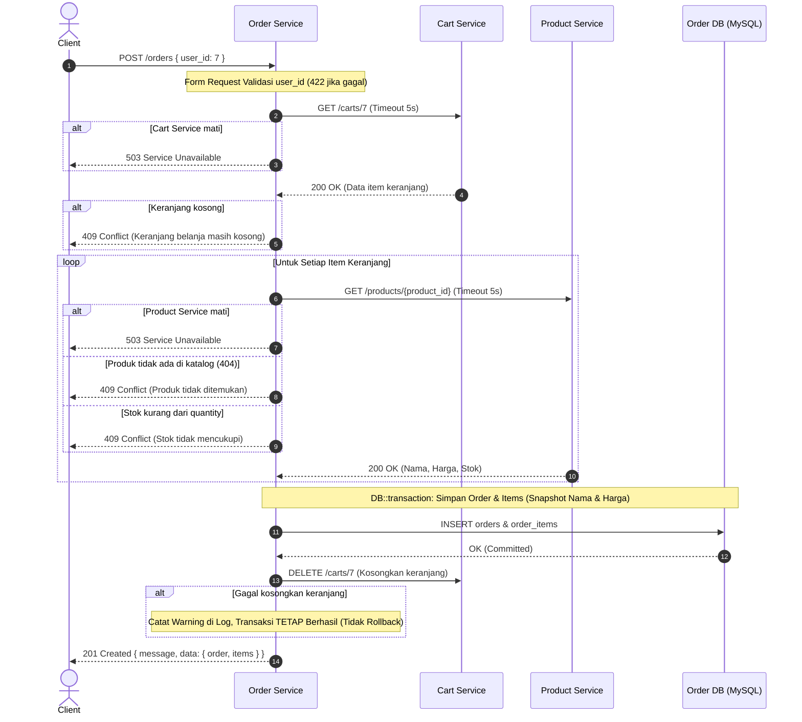

# E-Commerce Microservices: Order Service (UTS Microservices)

Repositori ini berisi implementasi sistem microservices e-commerce dengan penambahan **Order Service** yang dibangun menggunakan **Laravel** dan **MySQL**, serta diorkestrasi menggunakan **Docker Compose**. Proyek ini memenuhi seluruh spesifikasi Ujian Tengah Semester (Take Home) Mata Kuliah Microservices, Program Studi Teknologi Rekayasa Perangkat Lunak, Politeknik Negeri Padang.

---

## 1. Arsitektur Sistem

Sistem terdiri dari 4 layanan independen (microservices) dan 4 database terisolasi:

```mermaid
flowchart TD
    Client["Client / Postman / Insomnia"]

    subgraph Service Mesh
        OS["order-service (Laravel)\nPort: 3003"]
        CS["cart-service (Laravel)\nPort: 3001"]
        PS["product-service (Node.js/Express)\nPort: 3000"]
        RS["review-service (Python/Flask)\nPort: 3002"]
    end

    subgraph Databases
        ODB[("order-db (MySQL)\nPort: 3307")]
        CDB[("cart-db (PostgreSQL)\nPort: 5433")]
        PDB[("product-db (MySQL)\nPort: 3306")]
        RDB[("review-db (MongoDB)\nPort: 27017")]
    end

    Client -->|HTTP REST| OS
    Client -->|HTTP REST| CS
    Client -->|HTTP REST| PS
    Client -->|HTTP REST| RS

    OS -->|GET /carts/{userId}\nDELETE /carts/{userId}| CS
    OS -->|GET /products/{id}| PS
    CS -->|GET /products/{id}| PS
    RS -->|GET /products/{id}| PS

    OS --> ODB
    CS --> CDB
    PS --> PDB
    RS --> RDB
```

### Pembagian Lapisan Arsitektur Order Service (`Layered Architecture`)
Order Service menerapkan *separation of concerns* yang ketat:
1. **Routes (`routes/api.php`)**: Mendefinisikan endpoint tanpa prefix (`apiPrefix: ''`) dan meneruskan request ke controller.
2. **Form Request (`app/Http/Requests`)**: Menangani validasi input sebelum controller dieksekusi (`CreateOrderRequest`, `GetOrdersByUserRequest`). Mengembalikan kode status 422 dengan struktur seragam bila data tidak valid.
3. **Controller (`app/Http/Controllers/OrderController.php`)**: Mengatur alur HTTP, memanggil `OrderService`, menangkap exception khusus (*domain exceptions*), serta memformat response JSON dan kode status HTTP. Controller bebas dari query database dan logika bisnis.
4. **Service (`app/Services/OrderService.php`)**: Pusat logika bisnis (verifikasi keranjang tidak kosong, validasi ketersediaan dan stok produk, kalkulasi total snapshot, pembungkusan transaksi database `DB::transaction`, dan trigger pengosongan keranjang). Service tidak bergantung pada objek HTTP Laravel.
5. **Model Eloquent (`app/Models/Order.php`, `OrderItem.php`)**: Representasi entitas data dengan relasi `hasMany` dan `belongsTo`, casting data, query scopes (`forUser`, `withStatus`), serta atribut serialisasi JSON yang rapi.
6. **HTTP Clients (`app/Clients/CartServiceClient.php`, `ProductServiceClient.php`)**: Abstraksi komunikasi jaringan antar-service via HTTP dengan pembacaan URL dari environment variable, timeout wajib maksimal 5 detik, logging lengkap, serta translasi kegagalan jaringan menjadi `ServiceUnavailableException` (HTTP 503).

---

## 2. Alur Bisnis Checkout (`POST /orders`)



---

## 3. Port Mapping Layanan

| Layanan | Teknologi | Port Host | Port Kontainer | Keterangan Database |
| :--- | :--- | :--- | :--- | :--- |
| **product-service** | Node.js Express | `3000` | `3000` | MySQL (`3306`) |
| **cart-service** | Laravel 11/12 (PHP 8.4) | `3001` | `3001` | PostgreSQL (`5433` -> `5432`) |
| **review-service** | Python 3 Flask | `3002` | `3002` | MongoDB (`27017`) |
| **order-service** | Laravel 11/12 (PHP 8.4) | `3003` | `3003` | MySQL (`3307` -> `3306`) |

> [!NOTE]
> Database MySQL milik `order-service` di-expose ke host pada port **`3307`** agar tidak bentrok dengan database MySQL `product-service` yang berjalan pada port **`3306`**.

---

## 4. Langkah Menjalankan Seluruh Sistem

Sistem dirancang agar dapat langsung dijalankan dari hasil kloning repositori baru dengan satu perintah tanpa konfigurasi manual tambahan.

### Prasyarat
- [Docker](https://www.docker.com/) dan Docker Compose telah terpasang dan berjalan di komputer Anda.
- Port `3000`, `3001`, `3002`, `3003`, `3306`, `3307`, `5433`, dan `27017` tidak sedang digunakan oleh aplikasi lain.

### Langkah Eksekusi

1. **Clone repositori**:
   ```bash
   git clone <URL_REPOSITORI_ANDA>
   cd <NAMA_FOLDER_REPOSITORI>
   ```

2. **Jalankan seluruh layanan menggunakan Docker Compose**:
   ```bash
   docker compose up --build
   ```
   *Atau jalankan di background (daemon mode):*
   ```bash
   docker compose up --build -d
   ```

3. **Verifikasi status kontainer**:
   Pastikan seluruh kontainer berada dalam status `running` atau `healthy`:
   ```bash
   docker compose ps
   ```

4. **Verifikasi kesehatan layanan (Health Check)**:
   - Order Service: `curl http://localhost:3003/health`
   - Product Service: `curl http://localhost:3000/health`
   - Cart Service: `curl http://localhost:3001/health`
   - Review Service: `curl http://localhost:3002/health`

---

## 5. Spesifikasi API Order Service

Base URL: `http://localhost:3003`

### Ringkasan Endpoint

| Method | Endpoint | Fungsi | Kode Sukses | Kemungkinan Kode Gagal |
| :--- | :--- | :--- | :--- | :--- |
| `GET` | `/health` | Cek status hidup service | `200` | - |
| `POST` | `/orders` | Checkout isi keranjang jadi pesanan | `201` | `422`, `409`, `503`, `500` |
| `GET` | `/orders/{id}` | Detail satu pesanan beserta item | `200` | `404`, `500` |
| `GET` | `/orders/user/{userId}` | Daftar pesanan user (`?status=` opsional) | `200` | `404`, `422`, `500` |
| `PATCH` | `/orders/{id}/pay` | Simulasi pembayaran (PENDING -> PAID) | `200` | `404`, `409`, `500` |

---

### Contoh Request & Response

#### 1. GET `/health`
- **Request:**
  ```bash
  curl -X GET http://localhost:3003/health
  ```
- **Response Sukses (200 OK):**
  ```json
  {
    "status": "ok",
    "service": "order-service"
  }
  ```

---

#### 2. POST `/orders` (Checkout)
- **Request Header:** `Content-Type: application/json`
- **Request Body:**
  ```json
  {
    "user_id": 7
  }
  ```
- **Response Sukses (201 Created):**
  ```json
  {
    "message": "Pesanan berhasil dibuat",
    "data": {
      "id": 1,
      "user_id": 7,
      "status": "PENDING",
      "total_amount": 1050000,
      "items": [
        {
          "product_id": 1,
          "product_name": "Keyboard Mekanikal",
          "unit_price": 450000,
          "quantity": 2,
          "subtotal": 900000
        },
        {
          "product_id": 2,
          "product_name": "Mouse Wireless",
          "unit_price": 150000,
          "quantity": 1,
          "subtotal": 150000
        }
      ],
      "created_at": "2026-10-20T03:15:00+00:00",
      "updated_at": "2026-10-20T03:15:00+00:00"
    }
  }
  ```
- **Response Gagal - Body Tidak Valid (422 Unprocessable Content):**
  ```json
  {
    "message": "Data yang dikirim tidak valid",
    "errors": {
      "user_id": [
        "Field user_id wajib diisi"
      ]
    }
  }
  ```
- **Response Gagal - Keranjang Kosong (409 Conflict):**
  ```json
  {
    "message": "Keranjang belanja masih kosong"
  }
  ```
- **Response Gagal - Stok Kurang (409 Conflict):**
  ```json
  {
    "message": "Stok Monitor 24 Inch tidak mencukupi: diminta 11, tersedia 10"
  }
  ```
- **Response Gagal - Service Lain Bermasalah / Mati (503 Service Unavailable):**
  ```json
  {
    "message": "Product service tidak dapat dihubungi, coba lagi nanti"
  }
  ```

---

#### 3. GET `/orders/{id}` (Detail Pesanan)
- **Request:**
  ```bash
  curl -X GET http://localhost:3003/orders/1
  ```
- **Response Sukses (200 OK):**
  ```json
  {
    "message": "Berhasil mengambil pesanan",
    "data": {
      "id": 1,
      "user_id": 7,
      "status": "PAID",
      "total_amount": 1050000,
      "items": [
        {
          "product_id": 1,
          "product_name": "Keyboard Mekanikal",
          "unit_price": 450000,
          "quantity": 2,
          "subtotal": 900000
        },
        {
          "product_id": 2,
          "product_name": "Mouse Wireless",
          "unit_price": 150000,
          "quantity": 1,
          "subtotal": 150000
        }
      ],
      "created_at": "2026-10-20T03:15:00+00:00",
      "updated_at": "2026-10-20T04:02:00+00:00"
    }
  }
  ```
- **Response Gagal - Pesanan Tidak Ditemukan / ID Bukan Angka (404 Not Found):**
  ```json
  {
    "message": "Pesanan dengan id 99 tidak ditemukan"
  }
  ```

---

#### 4. GET `/orders/user/{userId}` (Daftar Pesanan User)
- **Request:**
  ```bash
  # Semua pesanan user
  curl -X GET http://localhost:3003/orders/user/7

  # Filter status PENDING
  curl -X GET "http://localhost:3003/orders/user/7?status=PENDING"
  ```
- **Response Sukses (200 OK):**
  ```json
  {
    "message": "Berhasil mengambil daftar pesanan",
    "data": [
      {
        "id": 2,
        "user_id": 7,
        "status": "PENDING",
        "total_amount": 150000,
        "items": [
          {
            "product_id": 2,
            "product_name": "Mouse Wireless",
            "unit_price": 150000,
            "quantity": 1,
            "subtotal": 150000
          }
        ],
        "created_at": "2026-10-20T05:10:00+00:00",
        "updated_at": "2026-10-20T05:10:00+00:00"
      }
    ]
  }
  ```
- **Response Gagal - Filter Status Tidak Valid (422 Unprocessable Content):**
  ```bash
  curl -X GET "http://localhost:3003/orders/user/7?status=SHIPPED"
  ```
  ```json
  {
    "message": "Data yang dikirim tidak valid",
    "errors": {
      "status": [
        "Status harus PENDING atau PAID"
      ]
    }
  }
  ```

---

#### 5. PATCH `/orders/{id}/pay` (Bayar Pesanan)
- **Request:**
  ```bash
  curl -X PATCH http://localhost:3003/orders/2/pay
  ```
- **Response Sukses (200 OK):**
  ```json
  {
    "message": "Pesanan berhasil dibayar",
    "data": {
      "id": 2,
      "user_id": 7,
      "status": "PAID",
      "total_amount": 150000,
      "items": [
        {
          "product_id": 2,
          "product_name": "Mouse Wireless",
          "unit_price": 150000,
          "quantity": 1,
          "subtotal": 150000
        }
      ],
      "created_at": "2026-10-20T05:10:00+00:00",
      "updated_at": "2026-10-20T05:12:00+00:00"
    }
  }
  ```
- **Response Gagal - Pesanan Sudah Berstatus PAID (409 Conflict):**
  ```json
  {
    "message": "Pesanan berstatus PAID, hanya pesanan PENDING yang dapat dibayar"
  }
  ```
- **Response Gagal - Pesanan Tidak Ditemukan (404 Not Found):**
  ```json
  {
    "message": "Pesanan dengan id 99 tidak ditemukan"
  }
  ```

---

## 6. Daftar Environment Variable

Setiap layanan membaca konfigurasinya dari environment variable yang telah didefinisikan pada `docker-compose.yml` maupun file `.env.example`:

### Order Service (`order-service/.env.example`)
| Variabel | Deskripsi | Default Docker |
| :--- | :--- | :--- |
| `APP_NAME` | Nama aplikasi | `order-service` |
| `APP_ENV` | Mode environment | `local` |
| `APP_KEY` | Kunci enkripsi Laravel | *(base64 string)* |
| `APP_DEBUG` | Mode debug (detail trace error) | `true` |
| `DB_CONNECTION`| Driver database | `mysql` |
| `DB_HOST` | Host database MySQL | `order-db` |
| `DB_PORT` | Port MySQL internal container | `3306` |
| `DB_DATABASE` | Nama database | `orderdb` |
| `DB_USERNAME` | Pengguna database | `appuser` |
| `DB_PASSWORD` | Kata sandi database | `apppassword` |
| `CART_SERVICE_URL` | URL basis Cart Service | `http://cart-service:3001` |
| `CART_SERVICE_TIMEOUT` | Batas waktu request Cart (detik) | `5.0` |
| `PRODUCT_SERVICE_URL` | URL basis Product Service | `http://product-service:3000` |
| `PRODUCT_SERVICE_TIMEOUT` | Batas waktu request Product (detik) | `5.0` |

---

## 7. Keputusan Desain dan Keterbatasan

### Keputusan Desain
1. **Snapshotting Harga dan Nama Produk**:
   Nama dan harga produk disalin (*snapshot*) secara persisten ke tabel `order_items` pada saat checkout dilakukan. Perubahan nama atau kenaikan/penurunan harga di `product-service` di masa mendatang tidak akan mempengaruhi pesanan yang sudah tercatat.
2. **Transaksi Atomik Database (`DB::transaction`)**:
   Penyimpanan record induk pesanan di tabel `orders` dan rincian item di `order_items` dibungkus dalam satu blok transaksi database. Jika terjadi kegagalan pada salah satu item, seluruh perubahan dibatalkan (*rollback*) secara otomatis tanpa meninggalkan data parsial.
3. **Resiliensi Pengosongan Keranjang**:
   Sesuai prinsip ketahanan sistem terdistribusi, request pengosongan keranjang (`DELETE /carts/{userId}`) dilakukan *setelah* pesanan berhasil dikomit ke database. Jika panggilan pengosongan keranjang mengalami timeout atau gagal, pesanan **tidak dibatalkan**. Sistem tetap mengembalikan kode 201 Created kepada klien dan mencatat peringatan (*warning*) ke log untuk ditindaklanjuti.
4. **Enkapsulasi Klien HTTP & Timeout Eksplisit**:
   Seluruh panggilan antar-service dienkapsulasi dalam kelas client (`CartServiceClient`, `ProductServiceClient`) dengan batas waktu (*timeout*) ketat 5 detik untuk mencegah *thread exhaustion* atau *cascading failures* ketika service dependensi mengalami kelambatan.
5. **Mode Debug Bersyarat**:
   Pesan teknis rinci (file, baris, stack trace) hanya disertakan pada response HTTP 500 dan 503 jika `APP_DEBUG=true`. Dalam lingkungan produksi, klien hanya menerima pesan kesalahan ramah pengguna.

### Keterbatasan Sistem
1. **Komunikasi Sinkron (HTTP REST)**:
   Order Service menggunakan komunikasi sinkron dengan Product Service dan Cart Service. Jika traffic melonjak tajam, antrian panggilan HTTP dapat menimbulkan latensi kumulatif. Di arsitektur produksi tingkat lanjut, pendekatan *Event-Driven* via message broker (seperti RabbitMQ atau Kafka) dengan pola SAGA akan lebih optimal.
2. **Pemeriksaan Stok Tanpa Reservasi Distributed Lock**:
   Pada implementasi ini, stok produk hanya diperiksa (*read-only*) tanpa pengurangan stok di `product-service` sesuai batas lingkup tugas. Pada sistem produksi, diperlukan mekanisme *distributed locking* atau *stock reservation* guna mencegah *race condition* (over-selling).
3. **Pembersihan Keranjang Non-Transaksional Lintas Service (Dual-Write)**:
   Karena tidak menggunakan *two-phase commit* (2PC), kegagalan pada pengosongan keranjang berpotensi meninggalkan item di keranjang user meskipun order sudah terbit. Hal ini dimitigasi dengan pencatatan log peringatan.

---

## 8. Panduan Menjalankan Skenario Demo Video

Berikut adalah panduan runut untuk mendemokan sistem dalam rekaman video demo (8 - 15 menit):

### 1. Pembukaan (±1 menit)
- Sapa penonton, sebutkan Nama, NIM, dan ringkasan solusi arsitektur microservices yang dibangun.

### 2. Penjelasan Arsitektur (±2 menit)
- Tampilkan diagram arsitektur microservices dan pembagian lapisan pada `order-service` (`Requests`, `Controllers`, `Services`, `Models`, `Clients`).

### 3. Menjalankan Sistem dari Awal (±1 menit)
- Jalankan perintah di terminal bersih:
  ```bash
  docker compose up --build
  ```
- Perlihatkan log container yang menyala dan selesainya migrasi database secara otomatis.

### 4. Demonstrasi Endpoint (4 - 6 menit)
Gunakan file `requests.http` atau Postman untuk menjalankan skenario:
1. **Health Check**:
   - `GET http://localhost:3003/health` -> 200 OK.
2. **Skenario Kegagalan `POST /orders`**:
   - Body kosong tanpa `user_id` -> **422 Unprocessable Content**.
   - User dengan keranjang kosong (misal `user_id: 999`) -> **409 Conflict** (`Keranjang belanja masih kosong`).
   - Keranjang dengan stok tidak cukup (misal 11 unit Monitor 24 Inch yang stoknya 10) -> **409 Conflict** (`Stok Monitor 24 Inch tidak mencukupi...`).
   - Matikan product-service (`docker stop product-service`), lalu checkout -> **503 Service Unavailable** (`Product service tidak dapat dihubungi, coba lagi nanti`). Tunjukkan log kegagalan di terminal order-service (`docker compose logs --tail=20 order-service`). Nyalakan kembali (`docker start product-service`).
3. **Skenario Sukses `POST /orders`**:
   - Isi keranjang user 7 (2 Keyboard Mekanikal + 1 Mouse Wireless).
   - Checkout `POST /orders { user_id: 7 }` -> **201 Created** (Total amount 1.050.000).
   - Verifikasi keranjang user 7 telah kosong (`GET /carts/7`).
4. **Skenario Snapshot Harga**:
   - Cek detail pesanan ID 1 -> harga keyboard 450.000.
   - Ubah harga keyboard di product-service menjadi 600.000 (`PUT /products/1`).
   - Cek kembali pesanan ID 1 -> terbukti harga di pesanan lama **tetap 450.000**.
5. **Skenario `GET /orders/{id}`**:
   - ID ada (`/orders/1`) -> **200 OK**.
   - ID tidak ada (`/orders/999`) -> **404 Not Found**.
   - ID bukan angka (`/orders/abc`) -> **404 Not Found**.
6. **Skenario `GET /orders/user/{userId}`**:
   - `/orders/user/7` -> **200 OK** (Daftar pesanan terbaru di atas).
   - Filter sah `/orders/user/7?status=PENDING` -> **200 OK**.
   - Filter tidak sah `/orders/user/7?status=SHIPPED` -> **422 Unprocessable Content**.
7. **Skenario `PATCH /orders/{id}/pay`**:
   - Bayar order status PENDING -> **200 OK** (Status berubah menjadi PAID).
   - Bayar ulang order yang sudah PAID -> **409 Conflict** (`Pesanan berstatus PAID, hanya pesanan PENDING yang dapat dibayar`).

### 5. Keputusan Desain (1 - 2 menit)
- Jelaskan trade-off snapshot harga, isolasi transaksi `DB::transaction`, serta penanganan kegagalan cart delete yang tidak menggagalkan order.

### 6. Penutup
- Sampaikan salam penutup dan terima kasih.

---

## 9. Riwayat Git Commit

Pengembangan dilakukan secara bertahap dengan riwayat commit yang jelas dalam Bahasa Indonesia:

1. `chore: inisialisasi struktur repositori dan konfigurasi layanan dasar`
2. `feat(order-service): inisialisasi struktur proyek Laravel dan konfigurasi dasar`
3. `feat(order-service): buat migrasi database untuk tabel orders dan order_items`
4. `feat(order-service): buat model Eloquent Order dan OrderItem beserta relasi hasMany dan belongsTo`
5. `feat(order-service): buat custom domain exceptions dan validasi form request`
6. `feat(order-service): implementasi HTTP client dengan timeout untuk cart-service dan product-service`
7. `feat(order-service): implementasi logika bisnis OrderService dengan transaksi database atomik`
8. `feat(order-service): implementasi HealthController, OrderController, dan rute API`
9. `feat(order-service): tambahkan Dockerfile untuk kontainerisasi dan migrasi otomatis`
10. `feat(docker): orkestrasi arsitektur multi-service dan database pada docker-compose`
11. `test(order-service): tambahkan pengujian unit dan feature untuk endpoint dan aturan bisnis`
12. `docs(api): sediakan berkas HTTP request untuk seluruh skenario pengujian dan demo`
13. `docs: buat dokumentasi README lengkap dengan diagram arsitektur, panduan instalasi, dan demo`
14. `feat(order-service): daftarkan service provider aplikasi`
15. `fix: perbaiki konfigurasi startup kontainer, scope model, dan bersihkan file redundan`

> **Catatan Pengumpulan**: Cantumkan SHA commit terakhir saat mengumpulkan via formulir UTS.
